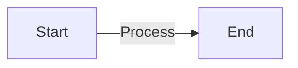
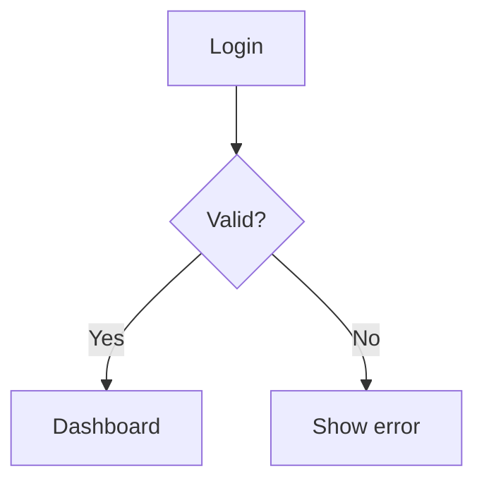
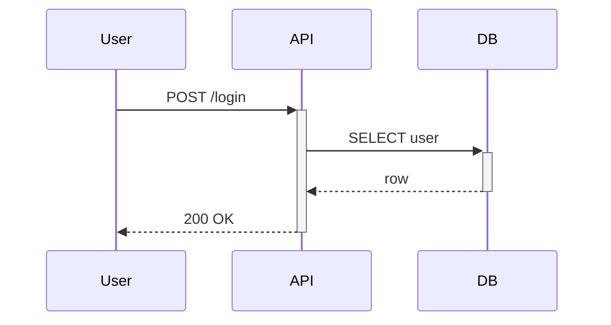
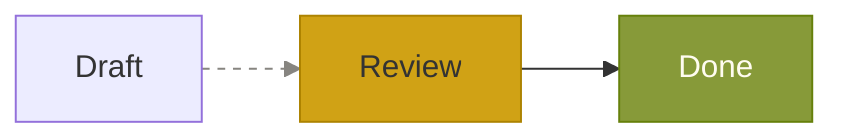

# Mermaid

Draws Mermaid diagrams with [Pele](https://pele.run), which turns Mermaid syntax
into SVG in the browser. Supports every diagram type of Mermaid 12.1. Pele is
embedded in Neko — a page loads it from its own `assets/` folder, only when the
page has a diagram, and a deck or document inlines it — so no CDN is involved and
the diagrams work offline.

## Basic flowchart

````markdown

````

## Decision tree

````markdown

````

## Sequence diagram

````markdown

````

## Other supported types

- `classDiagram` — class structure.
- `erDiagram` — entity relationships.
- `stateDiagram-v2` — state machines.
- `gantt` — project schedules.
- `journey` — user journeys.
- `mindmap` — radial idea maps.
- `sankey-beta` — flow diagrams.
- `xychart-beta` — quick bar / line charts.
- `architecture-beta` — cloud architecture.

## Theming

Diagrams adopt the site palette automatically — Neko maps Pele's colours onto the
site's theme variables (`--neko-primary-N`, `--neko-accent-N` — the resolved `theme`
colours + accent ramp from `neko.yml` — and `--neko-bg-elevated` etc.), with a light
and a dark set. A diagram is drawn once and follows light/dark mode with no redraw. No
directive needed.

## Colouring part of a diagram

`%%{init}%%` `theme` / `themeVariables` are ignored (the site theme decides the
colours). To colour individual nodes or links, use Mermaid's own `style`,
`classDef` and `linkStyle`; colours set this way are fixed and do not change with
the colour mode:

````markdown

````

## Zoom

A diagram that had to shrink to fit its box gets zoom and pan controls (buttons,
`Ctrl`/`⌘` + wheel, drag, double-click). The page still scrolls normally.

## Tips

- Keep node labels short.
- Use `graph LR` (left-to-right) for processes; `graph TD` (top-down) for
  hierarchies and decisions.
- For freeform relationship graphs without a fixed layout, use
  [`force-graph`](../force-graph/SKILL.md).
- For step-by-step processes, prefer [`workflow`](../workflow/SKILL.md) — it
  has a richer "lane" layout.
