# Mermaid

[Mermaid](https://mermaid-js.github.io/mermaid) is a diagramming and charting syntax that can be written inside Markdown code blocks. Neko draws it with [Pele](https://pele.run), a small renderer that turns Mermaid syntax into SVG and supports every diagram type of Mermaid 12.1.

Pele is embedded in Neko: a page loads it from your own site's `assets/` folder, and only when the page has a diagram. Nothing is fetched from a CDN, and a [deck](/presentations/deck-structure.md) or [document](/documents/document-structure.md) carries it inline, so it works offline.


## Component syntax

With a similar syntax to code blocks, creating a Mermaid diagram requires a `` ``` `` code fence with the inclusion of the `mermaid` specifier.

~~~ Sample Mermaid diagram
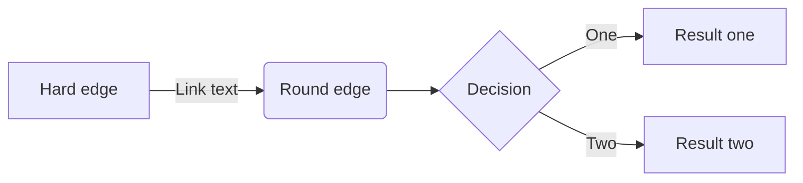
~~~


---

## Theming

Diagrams are drawn with your site's palette by default. Pele colours everything
from CSS variables, and Neko sets them from the resolved `theme` colours (primary
ramp) and accent ramp, so node fills, borders, lines and text follow the same
colours as the rest of the site — the same `theme.name` / `theme.colors` /
`theme.accent` you set in [`neko.yml`](/configuration/core/project). A diagram is
drawn once: switching between light and dark mode only changes the variables, so
the colours adapt immediately, with no redraw.

The ramps are exposed as CSS variables — `--neko-primary-50` … `--neko-primary-950`
and `--neko-accent-50` … `--neko-accent-950` — next to the page's surfaces
(`--neko-bg`, `--neko-bg-elevated`, `--neko-bg-muted`, `--neko-border`), and the
diagram's colours are mapped onto them, so your own CSS can use the same palette.

No configuration is needed — author the diagram as usual and it picks up the
brand colours. Charts (pie, XY, Gantt) take their series colours from the primary
and accent ramps, then a set of complementary hues.

A diagram can still colour individual parts itself, with Mermaid's `style`,
`classDef` and `linkStyle` statements. Colours set this way are fixed: they do
not change with the colour mode.

~~~
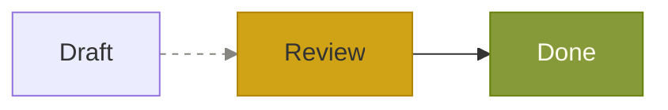
~~~


---

## Zooming

A diagram is drawn to fit the width of its box. One that has to shrink to fit gets
zoom and pan controls: pinch or hold `Ctrl`/`⌘` and scroll to zoom at the pointer,
drag to pan, double-click to zoom in or reset, and use the **+** / **−** buttons
or the `+` `-` `0` and arrow keys. Scrolling the page without a modifier key never
zooms the diagram.

---

## Directives

Mermaid [directives](https://mermaid-js.github.io/mermaid/#/directives) and front matter (`%%{init: { }}%%` as the first line just inside the `` ```mermaid `` block) are read for the configuration they set, to the extent each diagram type supports it.

Themes are the exception: `theme` and `themeVariables` are ignored, because the colours come from your site's theme (see [Theming](#theming)). To change the colours of a diagram, use `style`, `classDef` and `linkStyle` as shown above.

JavaScript callbacks in `click` statements are ignored; `click` links to `http`, `https`, `mailto` and `tel` URLs and relative paths still work.

### Syntax highlighting block

In order to draw a mermaid code block with syntax highlighting instead of rendering the contents, please use the `mermaid-js` block syntax specifier.

~~~
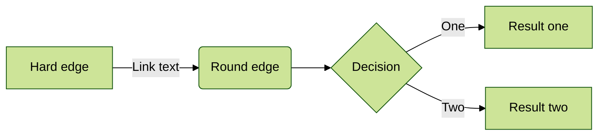
~~~


---

## Diagram types

### Flowchart

More details in the Mermaid [docs](https://mermaid-js.github.io/mermaid/#/flowchart).

~~~
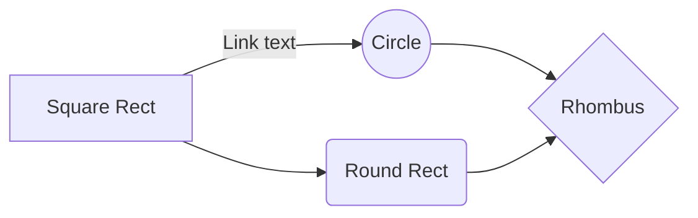
~~~


### Sequence diagram

More details in the Mermaid [docs](https://mermaid-js.github.io/mermaid/#/sequenceDiagram).

~~~
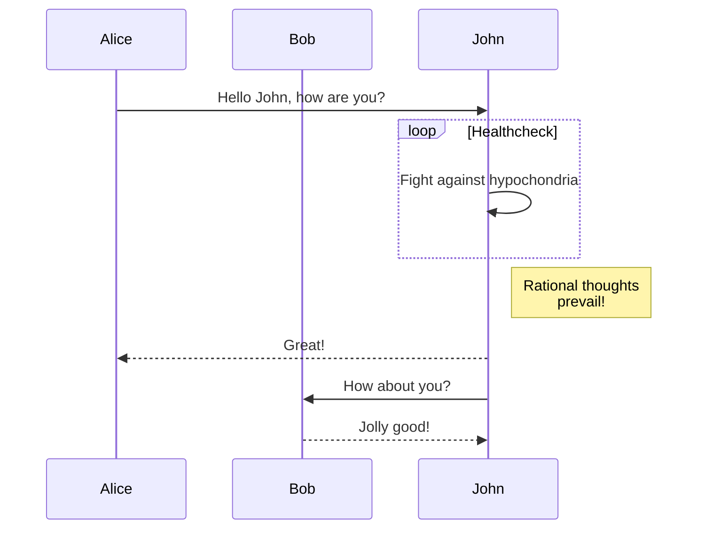
~~~


### Gantt diagram

More details in the Mermaid [docs](https://mermaid-js.github.io/mermaid/#/gantt).

~~~
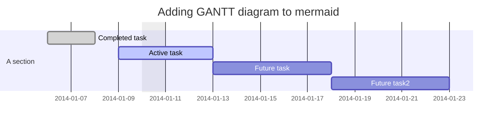
~~~


### Class diagram

More details in the Mermaid [docs](https://mermaid-js.github.io/mermaid/#/classDiagram).

~~~
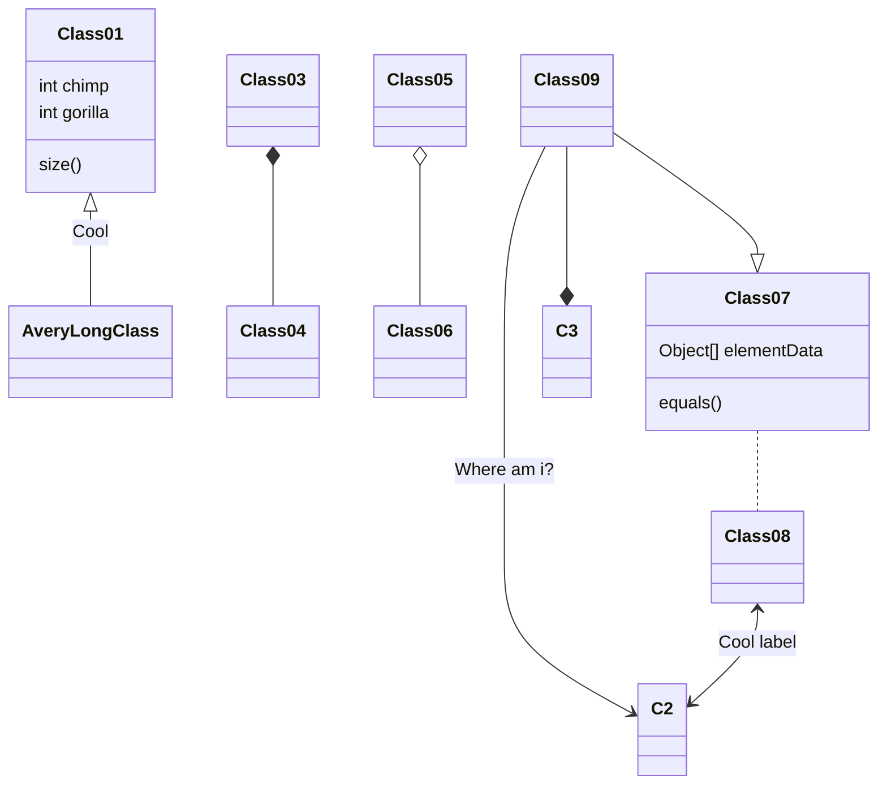
~~~


### Entity Relationship

More details in the Mermaid [docs](https://mermaid-js.github.io/mermaid/#/entityRelationshipDiagram).

~~~
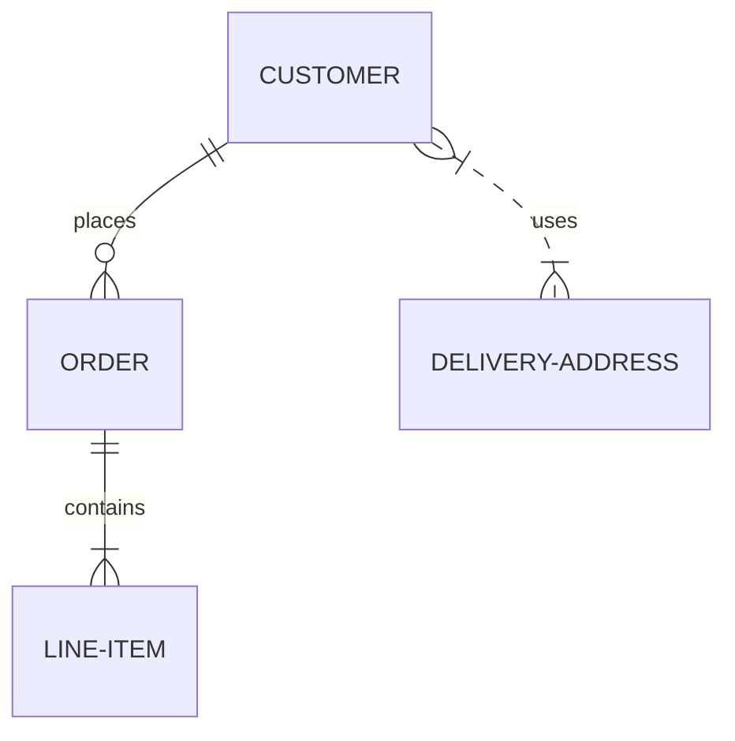
~~~


### User Journey

More details in the Mermaid [docs](https://mermaid-js.github.io/mermaid/#/user-journey).

~~~
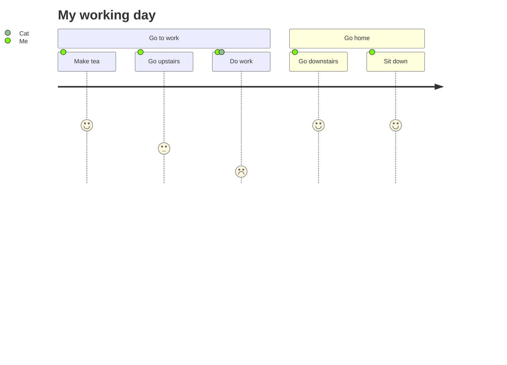
~~~


### Kanban diagram

More details in the Mermaid [docs](https://mermaid.js.org/syntax/kanban.html).

~~~
kanban
  Todo
    [Create Documentation]
    docs[Create Blog about the new diagram]
  [In progress]
    id6[Create renderer so that it works in all cases. We also add som extra text here for testing purposes. And some more just for the extra flare.]
  id9[Ready for deploy]
    id8[Design grammar]@{ assigned: 'knsv' }
  id10[Ready for test]
    id4[Create parsing tests]@{ ticket: MC-2038, assigned: 'K.Sveidqvist', priority: 'High' }
    id66[last item]@{ priority: 'Very Low', assigned: 'knsv' }
  id11[Done]
    id5[define getData]
    id2[Title of diagram is more than 100 chars when user duplicates diagram with 100 char]@{ ticket: MC-2036, priority: 'Very High'}
    id3[Update DB function]@{ ticket: MC-2037, assigned: knsv, priority: 'High' }

  id12[Can't reproduce]
    id3[Weird flickering in Firefox]
~~~

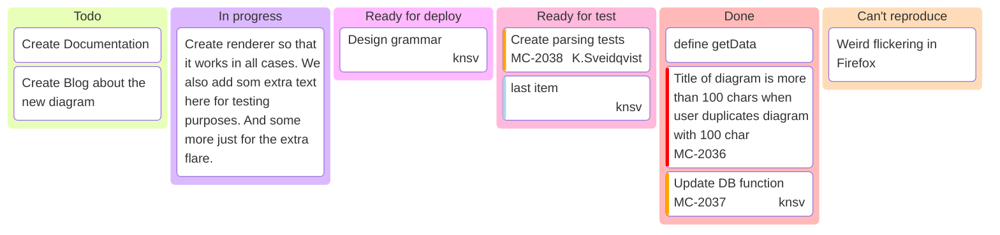


### Sankey diagram

More details in the Mermaid [docs](https://mermaid.js.org/syntax/sankey.html).

~~~
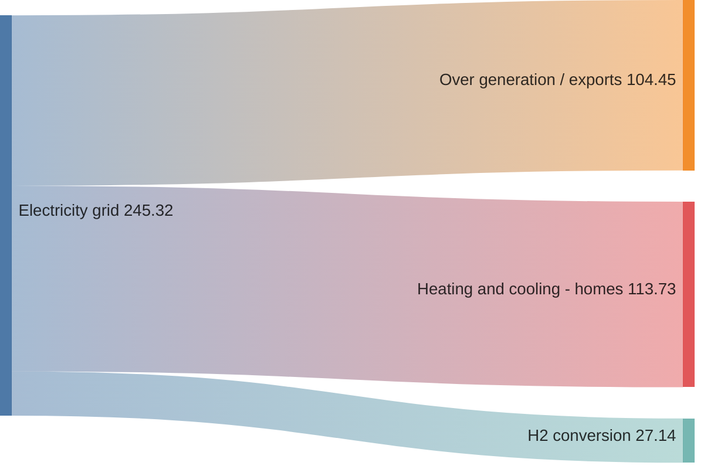
~~~

```mermaid
sankey-beta

%% source,target,value
Electricity grid,Over generation / exports,104.453
Electricity grid,Heating and cooling - homes,113.726
Electricity grid,H2 conversion,27.14
```

### Architecture diagram

More details in the Mermaid [docs](https://mermaid.js.org/syntax/architecture.html).

~~~
architecture-beta
    group api(cloud)[API]

    service db(database)[Database] in api
    service disk1(disk)[Storage] in api
    service disk2(disk)[Storage] in api
    service server(server)[Server] in api

    db:L -- R:server
    disk1:T -- B:server
    disk2:T -- B:db
~~~

```mermaid
architecture-beta
    group api(cloud)[API]

    service db(database)[Database] in api
    service disk1(disk)[Storage] in api
    service disk2(disk)[Storage] in api
    service server(server)[Server] in api

    db:L -- R:server
    disk1:T -- B:server
    disk2:T -- B:db
```

### XY Chart

More details in the Mermaid [docs](https://mermaid.js.org/syntax/xyChart.html).

~~~
xychart-beta
    title "Sales Revenue"
    x-axis [jan, feb, mar, apr, may, jun, jul, aug, sep, oct, nov, dec]
    y-axis "Revenue (in $)" 4000 --> 11000
    bar [5000, 6000, 7500, 8200, 9500, 10500, 11000, 10200, 9200, 8500, 7000, 6000]
    line [5000, 6000, 7500, 8200, 9500, 10500, 11000, 10200, 9200, 8500, 7000, 6000]
~~~

```mermaid
xychart-beta
    title "Sales Revenue"
    x-axis [jan, feb, mar, apr, may, jun, jul, aug, sep, oct, nov, dec]
    y-axis "Revenue (in $)" 4000 --> 11000
    bar [5000, 6000, 7500, 8200, 9500, 10500, 11000, 10200, 9200, 8500, 7000, 6000]
    line [5000, 6000, 7500, 8200, 9500, 10500, 11000, 10200, 9200, 8500, 7000, 6000]
```

### Sequence diagram

More details in the Mermaid [docs](https://mermaid.js.org/syntax/examples.html#basic-sequence-diagram).

```mermaid
sequenceDiagram
    Alice ->> Bob: Hello Bob, how are you?
    Bob-->>John: How about you John?
    Bob--x Alice: I am good thanks!
    Bob-x John: I am good thanks!
    Note right of John: Bob thinks a long<br/>long time, so long<br/>that the text does<br/>not fit on a row.

    Bob-->Alice: Checking with John...
    Alice->John: Yes... John, how are you?
```

[!ref :mermaid: Pele](https://pele.run)

[!ref :mermaid: Mermaid syntax reference](https://mermaid-js.github.io/mermaid/)