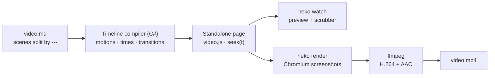

# Video mode

Video mode turns one Markdown file into a video. It is the same Neko build, the
same components and the same `neko watch` loop as decks and documents: a video is
just a page whose front matter says `video: true`. Each `---` rule starts a new
**scene**, every block in a scene **animates in on its own**, and
`neko render` films the result to an **MP4**.

[!video src="/videos/assets/neko-video.mp4" poster="/videos/assets/neko-video-poster.png" link="/videos/samples/neko-video" title="Write Markdown. Get video." description="The sample video: nine scenes in one Markdown file, in the curiosity theme, rendered with neko render. Open the composition to scrub it frame by frame in the browser."]

```markdown
---
title: Write Markdown. Get video.
video:
  theme: curiosity
  transition: push
---

--- {layout="cover" art="field" eyebrow="Neko · Video mode"}

# Write *Markdown.* Get *video.*

One file. Scenes split by a rule.

--- {layout="number" ground="deep" transition="zoom"}

::: counter {value="900" label="Frames in this film"}
:::
```

## How it works

The flow has three stages, and only the last one needs a browser.

1. **Build** — Neko splits the file into scenes, renders each one's Markdown,
   and runs its **timeline compiler** (C#) over the result: every element that
   moves gets a motion and a start time on the scene's clock, headlines are
   split into words, and each scene is sized and laid end to end with the
   transitions between them. All of that is written into the page as plain
   numbers.
2. **Preview** — the page is a self-contained player: the canvas scaled to the
   window, a play button and a scrubber marked at every scene. A small runtime
   (`video.js`, no animation library) turns a time into a frame. It is a pure
   function of time — no timers, no CSS animations — so the same moment always
   paints the same frame.
3. **Render** — `neko render` opens the page in headless Chromium (Playwright)
   at the video's own size, seeks it to each frame's time, takes a screenshot,
   and hands the frames to ffmpeg, which encodes the MP4 and mixes the
   soundtrack.



## Try it

```bash
neko watch                                  # preview at /videos/samples/neko-video
neko render videos/samples/neko-video.md    # writes videos/samples/neko-video.mp4
```

Both sample videos are Markdown files in this repository:

[!button variant="primary" text="The curiosity sample"](/videos/samples/neko-video) [!button variant="secondary" text="A tour of every component"](/videos/samples/component-tour)

[!video src="/videos/assets/component-tour.mp4" poster="/videos/assets/component-tour-poster.jpg" link="/videos/samples/component-tour" title="Video components, a tour" description="Every component in the default neko theme: lockup, typewriter, scramble, stats, line, donut and row charts, quote, steps, cards, a phone frame, a lower third, captions and the logo close."]

## What a video page is

- **It is a player, not an article.** No navbar, sidebar or footer — the canvas,
  a control bar, and a back link to the page you came from.
- **It never joins the sidebar or the search index.** Reach it from a page that
  embeds its render with `[!video]`.
- **It is self-contained.** Fonts, icons, highlight.js and the runtime are
  inlined, and local images become data URIs, so the page renders the same
  offline, in CI, and inside `neko render`.
- **It is deterministic.** Times are computed at build time and the runtime
  never reads the clock while rendering, so frames can be captured by several
  browser pages in parallel.

## Reading order

:::: card-grid
::: card {variant="grid" title="Video structure" link="/videos/video-structure" icon="file-code" palette="blue"}
The front matter, the scene separator, per-scene options and how Neko schedules every element.
:::

::: card {variant="grid" title="Video components" link="/videos/video-components" icon="cube" palette="violet"}
Lockups, swaps, typewriters, counters, charts, code, terminals, devices, cursors, lower thirds, captions, calls to action.
:::

::: card {variant="grid" title="Motion and transitions" link="/videos/video-motion" icon="bolt" palette="amber"}
The motions any block can take, scene transitions, camera moves, exits and timing attributes.
:::

::: card {variant="grid" title="Video themes" link="/videos/video-themes" icon="palette" palette="rose"}
The default neko look and the Curiosity brand theme with its grounds, layouts and generated art.
:::

::: card {variant="grid" title="Rendering to MP4" link="/videos/rendering" icon="film" palette="emerald"}
`neko render`: Playwright, ffmpeg, audio, quality, parallel capture and CI.
:::
::::

## Keyboard

| Input | Action |
| --- | --- |
| <kbd>Space</kbd> / <kbd>K</kbd> | Play / pause |
| <kbd>→</kbd> / <kbd>←</kbd> | Step one second (<kbd>Shift</kbd>: five) |
| <kbd>Home</kbd> / <kbd>End</kbd> | Start / end |
| <kbd>Esc</kbd> | Back out of the video |

A URL fragment `#t=12.5` opens the preview at that moment.
