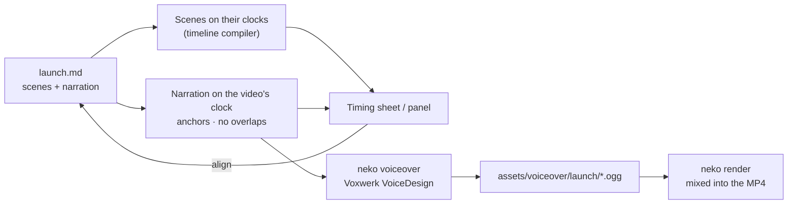

# Voice-over

A video can carry a **voice-over**: lines of narration written in the same
Markdown file, spoken by [Voxwerk](https://github.com/theolivenbaum/voxwerk)
(Qwen3-TTS in pure C#) in a voice you **describe** or pick from a catalog, and
mixed into the MP4 by `neko render`.

The narration is a **track of its own**. The scenes keep their animation on
their own clocks, exactly as they would without a voice; the voice-over is laid
on the **video's clock** at anchors you choose, and its lines **never overlap**.
Before anything is synthesized, Neko estimates every sentence, so you can line
the two up in the preview and only then spend time on the voice.

[!video src="/videos/assets/voice-over.mp4" poster="/videos/assets/voice-over-poster.jpg" link="/videos/samples/voice-over" title="A voice-over, written in Markdown" description="The narrated sample: five scenes and five lines of narration in one Markdown file, aligned with the timing panel and spoken by Voxwerk. Open the composition and press T to see the lanes."]

```markdown
---
title: Launch
video:
  narration:
    voice: "A warm, clear female narrator in her thirties, calm and friendly."
---

--- {id="opening" layout="title"}

# Say it *in Markdown*

--- {id="track"}

## The narration is *its own track*

- A time
- A scene
- An element {#element}

--- {narration}

{at="opening+0.6"}
Every Neko video can carry a voice-over, written in the same Markdown file.

{at="track"}
The narration is a track of its own. It never moves the animation.

{at="#element"}
Each line starts at an anchor: a time, a scene, or an element on screen.
```

## The workflow

1. **Write** the scenes as usual, and the narration in one or more
   `--- {narration}` parts.
2. **Preview** the timings: `neko voiceover launch.md --preview` prints every
   scene, animation and sentence on one clock, and the player's **Timing**
   panel draws them as lanes. Sentences not yet spoken are *estimated*.
3. **Align**: move anchors, change a scene's `duration`, split or shorten a
   line, until no line is pushed and nothing runs into the wrong scene.
4. **Synthesize**: `neko voiceover launch.md` speaks every sentence without a
   take and prints the sheet again, now with measured times.
5. **Render**: `neko render launch.md` mixes the takes into the MP4 (it
   synthesizes anything still missing first).



## Choosing a voice

The `narration:` key of the `video:` front matter sets the voice. A bare string
is the voice; a mapping takes the options below.

```yaml
video:
  narration: "An elderly man with a slow, raspy, gentle voice, like a grandfather telling a story."
```

```yaml
video:
  narration:
    voice: host                 # a name from `voices:`, a catalog id, or a description
    language: english
    seed: 7
    voices:
      host: "A bright, energetic young woman, upbeat and clear."
      guest: en-gb-rupert-vale  # a voice from the Voxwerk catalog
```

A **description** is the most direct: Voxwerk's VoiceDesign model creates the
voice from it — timbre, gender, age, accent, emotion, pace. A **catalog id**
(`<language>-<country>-<name>`) uses a ready-made voice from the
`Voxwerk.Voices.English` catalog, and is **cloned from the voice's reference
recording** with the Base checkpoint (`Qwen/Qwen3-TTS-12Hz-1.7B-Base`), so every
sentence is the same speaker. A described voice is designed afresh for each
sentence and drifts a little from take to take; a cataloged one does not. The
reference samples ship with Neko; `clone: false` designs a catalog voice from its
description instead. List and search the catalog with `neko voices`:

```bash
neko voices --search "calm narration" --gender female --country gb
neko voices --style Narration --age old --json
```

| Option | Default | Meaning |
| --- | --- | --- |
| `voice` | a calm, friendly narrator | A name from `voices`, a catalog id, or a description. |
| `voices` | — | Named voices a line picks with `{voice="name"}`. |
| `language` | the voice's, else `auto` | `english`, `german`, `french`, `spanish`, `italian`, `portuguese`, `russian`, `japanese`, `korean`, `chinese`. |
| `seed` | `7` | Sampling seed. The same voice, language, seed and text always give the same take. |
| `start` | `0.5` | When the first line starts, when it has no anchor. |
| `gap` | `0.5` | Seconds between two lines that follow each other. |
| `pause` | `0.25` | Seconds between the sentences of a line. |
| `volume` | `1` | Gain of the voice-over, 0 to 2. |
| `wpm` | `150` | Words per minute assumed for a sentence that has not been synthesized. |
| `model` | `Qwen/Qwen3-TTS-12Hz-1.7B-VoiceDesign` | The checkpoint that speaks described voices: a Hugging Face repo id or a local folder. |
| `clone` | `true` | Clone a catalog voice from its reference sample (one speaker throughout). `false` designs it from its description per sentence. |
| `cloneModel` | `Qwen/Qwen3-TTS-12Hz-1.7B-Base` | The Base checkpoint that clones catalog voices. |
| `folder` | `assets/voiceover/<page>` | Where the takes are kept, relative to the page. |

## Writing the narration

A part whose rule carries the `narration` flag — `--- {narration}` (or
`{voiceover}`) — is the voice-over track, not a scene. It can sit anywhere in the
file: at the end, after each scene, or both. Its parts are read in file order.

- Every **paragraph** or **list item** is a **line**. A line is split into
  **sentences**: the unit that is synthesized, timed and shown as a subtitle.
- A `{…}` block **at the end of a line**, or **on its own line just before it**,
  sets the line's anchor and voice.
- **Headings** label the script and are not spoken; HTML comments are ignored.
- Emphasis, links and code marks are taken out of what is said.

| Attribute | Meaning |
| --- | --- |
| `at` | The line's anchor (below). Without one, the line follows the line before. |
| `voice` | A name from `voices`, a catalog id, or a description. |
| `language` / `seed` | Per-line versions of the options. |
| `pause` | Seconds between this line's sentences. |
| `gap` | Seconds after the line before, when this line follows it. |
| `volume` | This line's gain. |

The part's own rule takes the same attributes as defaults for its lines:
`--- {narration voice="guest" at="scene-4"}` speaks every line of the part in the
guest's voice and starts the first one at scene 4.

## Anchors

| `at` | Starts the line… |
| --- | --- |
| `12.5`, `1:04.2` | At that time on the video's clock. |
| `+0.8` | 0.8 s after the line before has finished. |
| `scene-3`, `opening` | When scene 3 (or the scene with that `id`) has settled: its transition in is over. |
| `#chart`, `#element` | When the element with that id enters (`{#chart}` on any block, or a heading's own id). |
| `scene-3+1.2`, `#chart-0.3` | An anchor plus or minus seconds. |

### No overlaps

Lines are placed in order. A line whose anchor falls while the line before is
still speaking **waits** for it — it starts 0.15 s after — and Neko warns: the
timing sheet marks it *shifted*, and the panel outlines it. Fix it by moving the
anchor, lengthening the scene before, or shortening the line.

The animation never moves for the voice. The one exception is the end: when the
voice-over runs past the last scene, the **last scene holds** until it is done.

## Previewing the timing

```bash
neko voiceover videos/launch.md --preview          # the sheet, no model needed
neko voiceover videos/launch.md -p --json timing.json
neko render videos/launch.md --preview             # the same sheet
```

```
videos/launch.md: 0:20.46, 3 scenes, 4 voice-over lines in 5 sentences

  time      end       sc  animation                                      voice-over
  ──────────────────────────────────────────────────────────────────────────────────
  0:00.00   0:03.12   01  ▶ intro · title (start)
  0:00.30   0:01.15   01    Write Markdown. Get video.     words #write-…
  0:00.50   0:03.79   01                                                 ● Every video starts as one Markdown file.  [line 1.1 · runs into scene 2]
  0:02.52   0:05.83   02  ▶ scene-2 · default (push 0.6s)
  0:03.49   0:04.09   02    Paragraphs and quotes rise     rise #bullets
  0:06.10   0:11.78   03                                                 ● Nothing here needs a time…  [line 2 @ scene-2 ⚠ shifted]
```

`●` is a synthesized take, `~` an estimate. `runs into scene N` flags a sentence
that is still being spoken when the next scene arrives.

In the browser preview, **Timing** in the control bar (or <kbd>T</kbd>, or
`#timing` in the URL) opens the timing panel: the scenes, every animation and
every sentence as lanes on the video's clock, with the playhead. Click any item
to jump to it. The sentence being spoken shows as a **subtitle** under the canvas
(<kbd>C</kbd> hides it); estimated sentences show in italics, and synthesized ones
play their takes. Neither the panel nor the subtitle is ever filmed.

## Synthesizing

```bash
neko voiceover videos/launch.md            # speak every sentence that has no take
neko voiceover videos/ --threads 4         # every video page in the folder
neko voiceover videos/launch.md --force    # speak them all again
```

The first run downloads the VoiceDesign checkpoint (about 4.5 GB) to
`~/.cache/voxwerk`. Synthesis runs on the CPU, about five times slower than
real time on four cores, so a minute of narration takes a few minutes. Each
take is trimmed of the silence around it and kept as Ogg Opus in
`assets/voiceover/<page>/`, named by a hash of the model, voice, language, seed
and text: editing one sentence re-speaks only that sentence, and takes no
sentence uses any more are removed (`--keep-unused` keeps them).

Commit the takes with the page. The build copies them with the site's assets,
so the preview plays them, and a render in CI needs no model at all.

| Option | Meaning |
| --- | --- |
| `-p`, `--preview` | Only compute and print the timings. |
| `--json <file>` | Also write the sheet as JSON: scenes, animation, lines and sentences. |
| `-f`, `--force` | Synthesize every sentence again. |
| `--keep-unused` | Keep takes no sentence uses any more. |
| `--threads <n>` | Worker threads for synthesis (0 = all cores). |
| `--int8` | int8 talker weights: faster, approximate. |

## Rendering

`neko render` synthesizes any sentence still without a take, then mixes every
take into one voice-over track at its sentence's time, under the music bed and
any scene `voice` files. `--no-voiceover` skips the synthesis (sentences without a
take stay silent), and `--no-audio` leaves the whole soundtrack out.
